<a href="https://fredanthonygallano.vercel.app"><picture><source media="(prefers-color-scheme: dark)" srcset="assets/header-dark.svg"></picture></a>

  
  
  

I'm a fourth-year Information Systems student in Calapan City. I build web and mobile systems for real work: scholarship records, flood maps, shop inventory and library lending.

<a href="https://fredanthonygallano.vercel.app/projects"><picture><source media="(prefers-color-scheme: dark)" srcset="assets/projects-head-dark.svg"></picture></a>

  <a href="https://fredanthonygallano.vercel.app/projects/iskonnect"><picture><source media="(prefers-color-scheme: dark)" srcset="assets/projects/01-iskonnect-dark.svg"></picture></a>
  <a href="https://fredanthonygallano.vercel.app/projects/bahadvisory"><picture><source media="(prefers-color-scheme: dark)" srcset="assets/projects/02-bahadvisory-dark.svg"></picture></a>
  <a href="https://fredanthonygallano.vercel.app/projects/studyspace"><picture><source media="(prefers-color-scheme: dark)" srcset="assets/projects/03-studyspace-dark.svg"></picture></a>
  <a href="https://fredanthonygallano.vercel.app/projects/applypilot"><picture><source media="(prefers-color-scheme: dark)" srcset="assets/projects/04-applypilot-dark.svg"></picture></a>
  <a href="https://fredanthonygallano.vercel.app/projects/tailfinder"><picture><source media="(prefers-color-scheme: dark)" srcset="assets/projects/05-tailfinder-dark.svg"></picture></a>
  <a href="https://fredanthonygallano.vercel.app/projects/meu-gear-up"><picture><source media="(prefers-color-scheme: dark)" srcset="assets/projects/06-meu-gear-up-dark.svg"></picture></a>
  <a href="https://fredanthonygallano.vercel.app/projects/library-management"><picture><source media="(prefers-color-scheme: dark)" srcset="assets/projects/07-library-management-dark.svg"></picture></a>
  <a href="https://fredanthonygallano.vercel.app/projects/checkers"><picture><source media="(prefers-color-scheme: dark)" srcset="assets/projects/08-checkers-dark.svg"></picture></a>
  <a href="https://fredanthonygallano.vercel.app/projects/guhit-arts"><picture><source media="(prefers-color-scheme: dark)" srcset="assets/projects/09-guhit-arts-dark.svg"></picture></a>
  <a href="https://fredanthonygallano.vercel.app/projects"><picture><source media="(prefers-color-scheme: dark)" srcset="assets/projects/more-dark.svg"></picture></a>

<a href="https://fredanthonygallano.vercel.app/#stack"><picture><source media="(prefers-color-scheme: dark)" srcset="assets/stack-dark.svg"></picture></a>

<picture>
  <source media="(prefers-color-scheme: dark)" srcset="https://raw.githubusercontent.com/heyitsmefarid/heyitsmefarid/output/snake-dark.svg">
  
</picture>

Full details, screenshots and a contact form on <a href="https://fredanthonygallano.vercel.app">fredanthonygallano.vercel.app</a>

